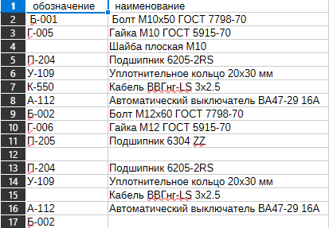
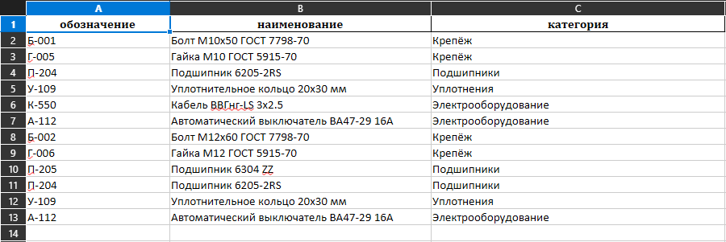

# gost-docs-automation

Автоматизирую подготовку ведомостей покупных изделий по ГОСТ: из «грязных» CSV в готовые Excel‑документы.

## Что делает скрипт

- Читает CSV с «грязными» данными: пустые ячейки, разный регистр, опечатки, лишние строки.
- Очищает и нормализует данные: удаляет строки без ключевых полей, приводит наименования к единому виду.
- Группирует позиции по категориям (крепёж, подшипники, уплотнения, электрооборудование и др.).
- Формирует итоговый Excel‑файл: отдельные листы по категориям + общий лист «Ведомость».

## Результат (до/после)

| До: сырой CSV с мусором | После: готовая ведомость |
| --- | --- |
|  |  |

## Как запустить

```bash
git clone https://github.com/AlexMayPool/gost-docs-automation.git
cd gost-docs-automation
pip install -r requirements.txt
python src/generate.py
```
## Технологии

- Python 3
- pandas — обработка и группировка данных
- openpyxl — запись Excel‑файлов с несколькими листами

## Входные данные

Файл `data/example_input.csv` — реалистичные «грязные» данные, как на реальных заводах (пустые строки, разный регистр, неполные записи, лишние символы).

## Выход

Файл `result/vedomost_result.xlsx` — готовая ведомость по ГОСТ с листами по разделам и итоговым листом.

## Контакты

Александр — Python-разработчик (автоматизация техдокументации) Telegram:@AlexMayPool 
